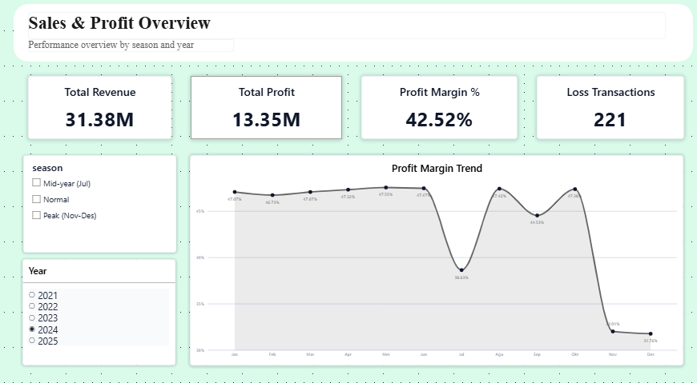
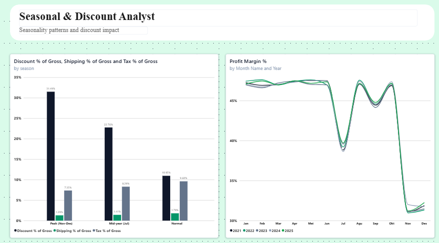
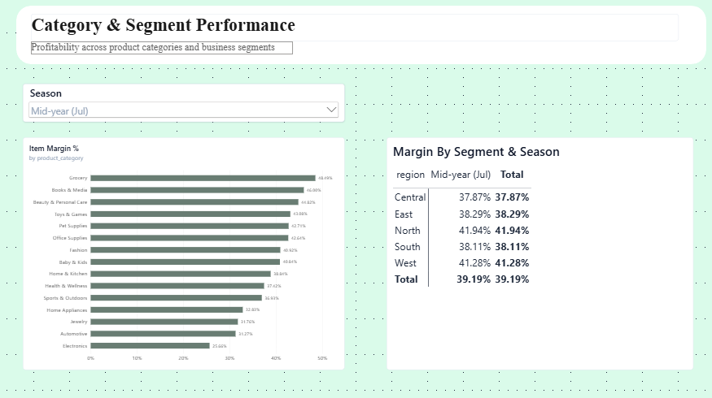
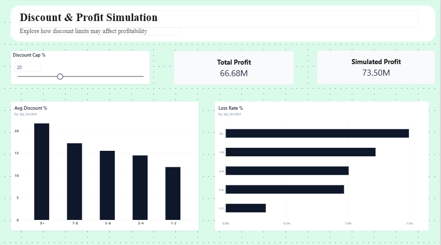

# Profit Leakage Analysis — E-Commerce Sales & Customer Analytics

> Analisis end-to-end untuk menemukan **di mana, kapan, dan mengapa** profit sebuah bisnis e-commerce bocor, lengkap dengan simulasi dampak perbaikan dan dashboard interaktif Power BI.


## 1. Latar Belakang & Pertanyaan Bisnis

Revenue perusahaan terlihat tumbuh, tetapi profitabilitasnya tidak konsisten, bahkan sebagian transaksi justru rugi (`profit < 0`).

| # | Pertanyaan analisis |
|---|---|
| 1 | **Kapan** ketidakkonsistenan profit terjadi: acak atau berpola waktu? |
| 2 | **Di mana** kebocoran terkonsentrasi: kategori, channel, region, atau tipe customer? |
| 3 | **Apa mekanismenya**: komponen biaya mana yang membuat transaksi bisa rugi? |

## 2. Ringkasan Hasil

| Metrik | Nilai |
|---|---|
| Periode data | 2021-01-01 s.d. 2025-12-31 |
| Order dianalisis (Completed + Returned) | 123.021 dari 138.116 order (89,1%) |
| Transaksi rugi | 1.229 (1,0%), dan 98,9% di antaranya terjadi pada Nov-Des |
| Diskon sebagai % gross sales | 10,95% (normal) → 22,76% (Juli) → **31,49%** (Nov-Des) |
| Margin profit | 46,90% (normal) → 39,19% (Juli) → **31,52%** (Nov-Des) |
| Simulasi cap diskon 20% saat Nov-Des | Profit naik **~10,2%** (~$6,8 juta total 2021-2025, rata-rata ~$1,4 juta/tahun); transaksi rugi 1.229 → 13 |

## 3. Dashboard

Dashboard interaktif Power BI: [`dashboard/profit_leakage_dashboard.pbix`](dashboard/profit_leakage_dashboard.pbix)

| Overview | Pola Musiman & Diskon |
|---|---|
|  |  |

| Category & Segment Performance | Interaksi Qty & Simulasi Diskon |
|---|---|
|  |  |

Detail tiap halaman ada di [`dashboard/README.md`](dashboard/README.md).

## 4. Metodologi

Alur mengikuti kerangka CRISP-DM:

1. **Business Understanding**: menurunkan problem statement menjadi 3 pertanyaan dan 4 hipotesis.
2. **Data Understanding**: 5 tabel, pengecekan integritas referensial dan duplikat.
3. **Data Preparation**: scope hanya order `Completed` dan `Returned`; fitur turunan (`season`, `discount_pct_of_gross`, `is_loss`, `qty_bucket`).
4. **EDA & pengujian hipotesis** (H1-H4, deskriptif).
5. **Root cause synthesis**.
6. **Simulasi dampak** cap diskon.
7. **Rekomendasi**.

### Keputusan analisis penting

| Keputusan | Alasan |
|---|---|
| Tabel order-level jadi *source of truth* untuk angka agregat | Net sales-nya persis sama dengan `dataset_statistics.csv` ($177.134.263,74). Total profit di `order_items` ($82,7 juta) selisih ~$6,5 juta dari tabel order-level ($76,1 juta). |
| Order `Cancelled` dan `Pending` dikeluarkan | Cancelled tidak pernah terealisasi; Pending belum jelas hasilnya. |
| Order `Returned` tetap dipakai | Biaya fulfillment sudah keluar, jadi retur termasuk kebocoran nyata. |
| `order_items` + `product_catalog` hanya untuk breakdown kategori | Info kategori tidak ada di tabel order-level. |

### Hipotesis dan status

| Hipotesis | Hasil | Catatan |
|---|---|---|
| **H1** Penurunan profit berkaitan dengan musim tertentu | Didukung (revisi: ada 2 musim) | Dip dalam setiap Nov-Des (~31-33%) dan dip sedang setiap Juli (~38-40%), berulang 2021-2025. |
| **H2** Kebocoran terkonsentrasi di segmen tertentu | Didukung sebagian (direvisi) | Penurunan margin relatif seragam antar channel/region/kategori (~20-24 poin). Dampaknya paling parah di kategori margin tipis (Electronics, Automotive, Jewelry, Home Appliances) karena margin dasarnya sudah rendah. |
| **H3** Diskon adalah komponen biaya utama penggerus profit | Didukung | Diskon naik ~3x lipat, sementara ongkir dan pajak turun sebagai % gross sales. |
| **H4** Quantity x diskon memperparah kerugian | Didukung | Korelasi qty vs diskon% naik dari 0,044 (normal) menjadi 0,265 (peak). |

## 5. Temuan Utama (Fakta vs Interpretasi)

**Fakta (terukur dari data)**
- Margin turun berulang di Juli dan Nov-Des setiap tahun.
- Pada Nov-Des, diskon rata-rata 31,49% dari gross sales (vs 10,95% di periode normal).
- Rata-rata diskon pada transaksi rugi 51,7% (vs 15,7% pada transaksi untung).
- Pada peak season, rata-rata diskon naik seiring quantity: 18,7% (1-2 item) → 32,9% (9+ item).

**Interpretasi (kesimpulan analis, bukan hasil uji kausal)**
- Pola ini konsisten dengan diskon musiman yang ditumpuk dengan bulk discount tanpa batas atas (*margin floor*).
- Revenue tahunan relatif flat (~$35-38 juta), sehingga "pertumbuhan" yang terlihat lebih mirip lonjakan volume musiman daripada pertumbuhan struktural.

## 6. Rekomendasi

1. **Margin floor rule** pada sistem promo (mis. net margin minimal 20%), terutama untuk kategori margin tipis.
2. **Review tiered/bulk discount** agar tidak naik tanpa batas atas saat ditumpuk promo musiman.
3. **Strategi khusus kategori margin tipis**: diskon nominal ber-cap, bundling, atau margin protection dari supplier.
4. **Audit per `campaign_name`** pada Juli dan Nov-Des untuk menemukan kampanye yang paling menggerus margin.
5. **Dashboard margin real-time** selama kampanye berjalan.

## 7. Keterbatasan

- Pengujian hipotesis bersifat **deskriptif**; belum ada uji signifikansi statistik. Korelasi qty-diskon tidak membuktikan hubungan sebab-akibat.
- Simulasi cap diskon **tidak memperhitungkan elastisitas permintaan**: asumsinya volume order tidak berubah saat diskon dikurangi, jadi angka $6,8 juta adalah batas atas yang optimistis, bukan prediksi.
- Basis simulasi adalah order Completed + Returned (total profit $66,7 juta), bukan seluruh 138.116 order.
- Selisih ~$6,5 juta antara profit `order_items` dan tabel order-level belum dapat dijelaskan dari data yang tersedia.
- Analisis per kampanye (`campaign_name`) belum dilakukan.

## 8. Struktur Repository

```
profit-leakage-analysis/
├── README.md
├── LICENSE
├── requirements.txt
├── .gitignore
├── data/
│   ├── README.md                 # sumber data & cara menaruh file
│   ├── raw/                      # taruh 5 CSV asli di sini (tidak di-commit)
│   ├── sample/                   # sampel kecil untuk demo (di-commit)
│   └── processed/                # output data preparation (tidak di-commit)
├── notebooks/
│   └── 01_profit_leakage_analysis.ipynb
├── dashboard/
│   ├── README.md
│   ├── profit_leakage_dashboard.pbix
│   └── screenshots/              # screenshot tiap halaman dashboard
├── presentation/
│   └── Presentasi_Final_Project.pptx
├── reports/
│   └── figures/                  # grafik hasil ekspor (opsional)
└── docs/
    └── data_dictionary.md
```

## 9. Cara Menjalankan

```bash
# 1. Clone & install
git clone https://github.com/<username>/profit-leakage-analysis.git
cd profit-leakage-analysis
python -m venv .venv && source .venv/bin/activate   # Windows: .venv\Scripts\activate
pip install -r requirements.txt

# 2a. Data lengkap: taruh 5 file CSV di data/raw/ (lihat data/README.md)
jupyter lab notebooks/01_profit_leakage_analysis.ipynb

# 2b. Demo cepat dengan sampel (angka akan berbeda dari laporan)
DATA_DIR=../data/sample jupyter lab notebooks/01_profit_leakage_analysis.ipynb
```

Notebook juga berjalan di Google Colab (path terdeteksi otomatis).
Untuk dashboard, buka file `.pbix` dengan Power BI Desktop.

## 10. Tools

Python (pandas, matplotlib), Jupyter, Power BI, PowerPoint.

## 11. Penulis

**[Nama Lengkap Kamu]** — Junior Web Developer & Data Analyst
[LinkedIn](https://linkedin.com/in/<username>) · [GitHub](https://github.com/<username>) · [Email](mailto:email@kamu.com)

Final project program *Data Analyst & Business Intelligence* — Dibimbing.
